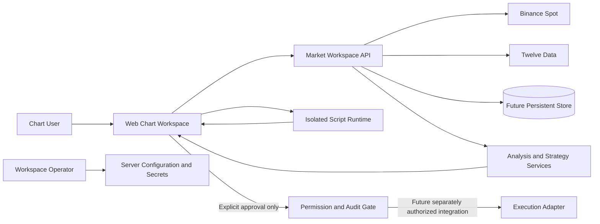
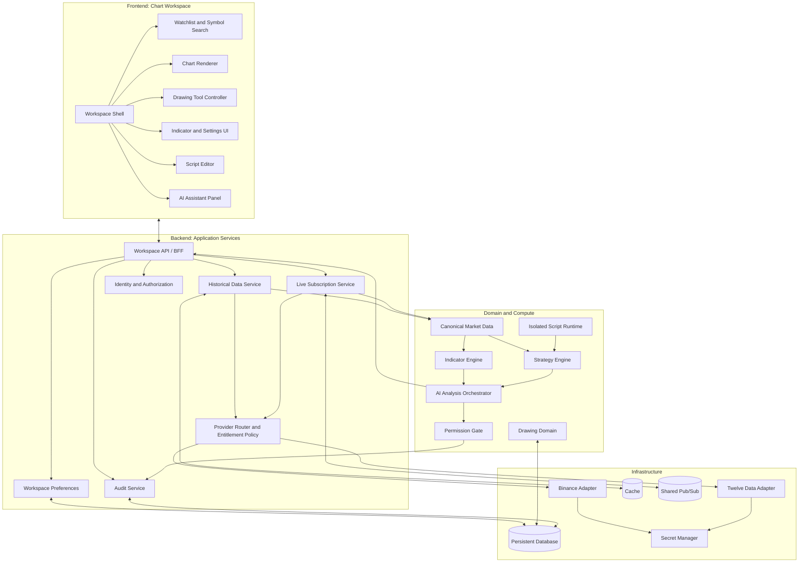

# Market Workspace Architecture Blueprint

**Status:** Proposed target architecture  
**Baseline commit:** `4f43d6d627c5fe2a3c57ebd03fa55fd53f4c3631`  
**Scope:** Charting, market data, indicators, drawing tools, Pine-compatible scripting, strategy research, AI analysis, and permission-gated actions.

This document separates the **implemented baseline** from the **proposed target**. A component described as proposed is not represented as already implemented.

## 1. Architectural goals

1. Deliver accurate, traceable market data for multiple asset classes and providers.
2. Keep vendor credentials and provider connections on the server.
3. Keep chart rendering responsive while isolating calculations and untrusted scripts.
4. Make indicators, drawings, scripts, and strategies composable without coupling them to a specific data vendor.
5. Treat AI output as analysis or a proposal, never as authority to execute a trade.
6. Make every consequential action explicit, permissioned, auditable, and reversible where possible.
7. Allow the system to scale from one API instance to multiple instances without changing the public chart contract.

### Non-goals for the current milestone

- Brokerage connectivity, order placement, account custody, or autonomous trading.
- Claiming full TradingView/Pine Script compatibility.
- Treating a generated strategy result as evidence of future profitability.
- Using AI to bypass validation, user permissions, risk limits, or provider licensing.

## 2. System context

### Actors

- **Chart user:** selects instruments and timeframes, views candles, adds indicators and drawings.
- **Workspace owner:** configures provider credentials, data entitlements, allowed origins, and operational limits.
- **Strategy author:** creates and tests scripts or strategy definitions in an isolated environment.
- **AI assistant:** reads approved market snapshots and strategy outputs, then produces explanations and proposals.
- **External providers:** Binance Spot for crypto market data and Twelve Data for Forex market data in the current provider set.

### Context diagram



The execution adapter is a future boundary only. It is not part of the present product and must remain disabled until a separate security, legal, and risk review is approved.

## 3. Current implementation baseline

The repository currently contains three principal packages:

| Area | Implemented responsibility |
|---|---|
| `apps/web` | React, TypeScript, Vite, Lightweight Charts; Crypto/Forex selection; symbol and timeframe selection; historical candle fetch; SSE live updates |
| `apps/api` | Fastify API; historical provider routing; server-side Binance and Twelve Data adapters; live subscription hub; SSE route; request security controls |
| `packages/contracts` | Shared Zod schemas and TypeScript types for candles, timeframes, market requests, and live events |

### Current data flow

1. The browser requests historical candles from the API.
2. The API selects the provider by market type.
3. The provider response is bounded, parsed, normalized, and validated.
4. The browser opens the API SSE endpoint.
5. The API live hub shares upstream subscriptions and fans out normalized candle events.
6. The chart updates the active candle without repeatedly replacing the full historical series.

### Current provider responsibilities

- **Binance Spot:** crypto historical candles and live kline events. Supported intervals are the Binance Spot intervals declared in the shared contract.
- **Twelve Data:** Forex history and live price ticks, subject to server-side API-key and display-license attestation. Live ticks are aggregated into OHLC candles by interval on the server.
- **Browser:** receives normalized market events only. It must not connect directly to provider WebSockets or receive provider credentials.

### Known current limitations

- The live hub and subscription accounting are process-local.
- Forex tick aggregation does not by itself repair gaps after provider disconnects; historical reconciliation is required.
- The chart workspace is an early foundation, not yet a complete charting terminal.
- Watchlists, indicator execution, drawing persistence, script execution, strategy backtesting, AI analysis, user authentication, and audit persistence are not complete.
- A passing CI run does not prove live provider connectivity, provider licensing, or production readiness.

## 4. Target logical architecture

The target is divided into bounded modules. Modules communicate through explicit contracts rather than importing one another's implementation details.



The diagram is a target, not a claim that all boxes exist today.

## 5. Frontend architecture

### 5.1 Workspace shell

Owns page layout, selected workspace, active market, active symbol, timeframe, panel layout, and route-level state. It should not contain provider-specific logic.

Suggested feature boundaries:

- `features/workspace`: workspace shell and panel layout.
- `features/watchlist`: watchlist, symbol search, and instrument selection.
- `features/chart`: chart lifecycle, series, viewport, crosshair, and event integration.
- `features/drawings`: drawing tools and interaction state.
- `features/indicators`: indicator catalogue, configuration UI, and visibility.
- `features/scripts`: script editor, diagnostics, and execution requests.
- `features/strategies`: strategy configuration and result visualization.
- `features/assistant`: read-only analysis, explanations, and approval prompts.

Feature modules should expose typed commands and view models. Avoid a giant root component containing every feature's state.

### 5.2 Chart renderer boundary

The chart renderer is an adapter around Lightweight Charts. It should receive:
- normalized candle series,
- normalized indicator series,
- drawing overlays,
- viewport commands,
- chart interaction events.

It should not fetch data, choose providers, calculate strategy decisions, or hold API credentials.

Use a stable chart controller interface so the rendering library can be replaced or upgraded without rewriting market-data, indicator, or strategy domains.

### 5.3 State ownership

- **Server state:** historical candles, live feed status, symbol metadata, provider status, saved workspace settings.
- **Local interaction state:** active drawing gesture, crosshair selection, temporary form edits, open menus.
- **Persisted user state:** watchlists, layouts, indicator configurations, drawings, saved scripts, and strategy definitions.
- **Derived state:** indicator output and chart view models, recomputable from validated source inputs.

Do not persist high-frequency mouse movement or every live tick as user preference data.

## 6. Canonical market-data domain

### 6.1 Normalized candle contract

The canonical candle remains provider-neutral:

- `time`: UTC Unix seconds, aligned to the interval boundary.
- `open`, `high`, `low`, `close`: finite numeric prices.
- `volume`: optional, non-negative, and present only when the provider supplies meaningful volume.

A market event should also identify market, symbol, timeframe, provider, event timestamp, receive timestamp, and candle closure state.

### 6.2 Provider adapter contract

Each adapter is responsible for:
- provider-specific authentication,
- symbol and interval translation,
- connection lifecycle and reconnect,
- provider message parsing,
- rate and quota compliance,
- conversion to canonical domain events,
- health and stale-data signals.

Adapters must not leak provider payloads into the browser. The provider router owns asset-class selection, capability checks, licensing policy, and fallback policy.

### 6.3 Provider capability registry

Do not assume every provider supports every market or timeframe. Maintain an explicit capability declaration:

```ts
interface ProviderCapabilities {
  providerId: string;
  markets: readonly ("crypto" | "forex" | "equity" | "index" | "commodity")[];
  supportedTimeframes: readonly string[];
  supportsHistorical: boolean;
  supportsStreaming: boolean;
  supportsVolume: boolean;
  displayEntitlementRequired: boolean;
}
```

The registry is validated at startup. Unsupported requests fail explicitly; the system must never silently substitute a different timeframe or stale provider.

### 6.4 Data quality and recovery

The live pipeline must track:
- last provider event time,
- last server receive time,
- last browser receive time,
- connection state,
- sequence or event ordering where provider data supplies it,
- detected time gaps,
- historical reconciliation status.

After reconnect, the recovery flow is:
1. Mark the feed as recovering, not live.
2. Fetch historical candles from the last confirmed candle boundary with a bounded overlap.
3. Validate and deduplicate by symbol, timeframe, and candle timestamp.
4. Merge in timestamp order.
5. Resume live updates only after the stream is healthy.
6. Expose any unresolved gap to the UI.

For Forex tick aggregation, the server should preserve candle state and reconcile the incomplete interval with licensed historical data. Tick-only OHLC is an estimate of the provider's received tick sequence, not a guarantee of every market transaction.

### 6.5 Scaling the live hub

Before horizontal scaling:
- replace process-local fanout with shared pub/sub,
- centralize subscription ownership or use deterministic sharding,
- enforce quotas globally, not only per process,
- cap per-user and per-IP subscriptions,
- implement bounded queues and backpressure,
- define reconnect and replay semantics,
- instrument provider connection count, active symbols, event lag, and dropped messages.

Redis or another managed pub/sub may be evaluated, but the architecture must depend on an interface, not a specific vendor.

## 7. Indicators and drawing tools

### 7.1 Indicator engine

Indicators are pure computations over canonical input series. They must not make network requests or mutate source candles.

Proposed interface:

```ts
interface IndicatorDefinition<TConfig> {
  id: string;
  version: number;
  validateConfig(input: unknown): TConfig;
  calculate(input: IndicatorInput, config: TConfig): IndicatorOutput;
}
```

Requirements:
- deterministic output for the same input and configuration,
- explicit warm-up periods and missing-value behavior,
- bounded memory and computation,
- versioned configuration,
- unit tests against known reference datasets,
- incremental updates for the latest candle where safe,
- full recomputation when historical corrections invalidate prior output.

Start with a small verified catalogue (SMA, EMA, RSI, MACD, Bollinger Bands, ATR, VWAP where volume semantics permit). Each indicator must document formula, parameters, warm-up behavior, and whether it is meaningful for the selected asset class.

### 7.2 Drawing domain

Drawings are user-owned chart annotations, not market data. Store them separately from candle series.

A drawing record should include:
- stable ID and owner/workspace ID,
- instrument and timeframe context,
- drawing type,
- normalized anchor points,
- style settings,
- schema version,
- created/updated timestamps.

The renderer translates domain drawing records into chart-library primitives. Validate coordinates and object size at the API boundary. Support undo/redo through commands, not ad hoc mutation of chart internals.

## 8. Script and strategy architecture

### 8.1 Script compatibility strategy

Do not promise Pine Script compatibility until language coverage and behavior are formally specified. Build a constrained, documented script language in stages, then add compatibility only where tests demonstrate equivalent semantics.

Proposed stages:
1. Lexer and parser with a versioned grammar.
2. Typed intermediate representation (IR).
3. Static validation and resource estimation.
4. Deterministic evaluator over historical candle arrays.
5. Sandboxed execution for user-submitted scripts.
6. Strategy simulation and result reporting.

### 8.2 Isolated execution

Untrusted scripts must never execute inside the API process with unrestricted Node.js capabilities.

The runtime should have:
- separate process or isolated worker boundary,
- no filesystem or network access by default,
- strict CPU, memory, instruction, and wall-clock limits,
- bounded input and output sizes,
- no environment-variable or secret access,
- cancellation and hard termination,
- versioned runtime and reproducible inputs,
- audit records for script creation and execution.

A browser Web Worker may be useful for local previews, but it is not a security boundary for server-side execution or shared results. Server execution requires a hardened isolation mechanism.

### 8.3 Strategy engine

The strategy engine consumes canonical historical data and deterministic indicator/script outputs. It must produce reproducible results with:
- explicit strategy version and parameters,
- data provider and dataset range,
- fees, spread, slippage, and execution assumptions,
- no look-ahead bias,
- no future candle leakage,
- clear handling of missing data and partial candles,
- out-of-sample evaluation,
- metrics with definitions,
- warnings that backtests do not guarantee future results.

Strategy simulation is not brokerage execution. Keep those domains separate.

## 9. AI analysis and permission boundary

### 9.1 AI assistant scope

The AI assistant may:
- summarize validated market conditions,
- explain indicator and strategy outputs,
- compare a strategy's historical behavior with current market context,
- identify uncertainty, missing data, and conflicting signals,
- draft a proposed action for user review.

It must not:
- fabricate prices or silently fill missing data,
- treat its own output as a validated signal,
- change risk settings,
- submit orders,
- bypass user permissions,
- invoke tools outside its explicit capability set.

### 9.2 Analysis pipeline

1. Read-only snapshot service produces a timestamped, provenance-bearing market snapshot.
2. Analysis engine receives only approved fields and tool capabilities.
3. Strategy library provides versioned strategy definitions and prior evaluation results.
4. Output schema requires rationale, evidence references, confidence/uncertainty, invalidation conditions, and data freshness.
5. A validator checks output structure and referenced data.
6. The UI presents a proposal with risks and limitations.
7. Any future consequential action requires a separate permission service and explicit user confirmation.
8. Every approval, rejection, expiry, and action result is written to an append-only audit trail.

### 9.3 Permission model

Use deny-by-default capabilities. An approval should be scoped to:
- exact action,
- instrument/account if relevant,
- parameters and maximum limits,
- expiry time,
- one-time or explicitly bounded repetition,
- user identity and session.

Approval of one proposal must not authorize later proposals. No AI-generated action may execute solely because a model returned an affirmative response.

## 10. Persistence and data ownership

Proposed persistent domains:

| Domain | Data | Ownership |
|---|---|---|
| Identity | users, sessions, roles | authentication service |
| Workspace | layouts, panels, preferences | workspace service |
| Watchlist | ordered symbols and labels | user/workspace |
| Drawings | chart annotations and versions | user/workspace |
| Indicators | instance configuration and visibility | workspace |
| Scripts | source, language version, validation results | script service |
| Strategies | definitions, parameters, versions | strategy service |
| Backtests | immutable run configuration, data provenance, results | strategy service |
| Audit | approvals, rejections, privileged operations | audit service |

Use relational storage for ownership, permissions, and versioned configuration. Cache market history and derived results separately with explicit expiry and provider provenance. Do not treat cache as the source of truth for user-owned records.

## 11. Security and operational requirements

- Provider credentials live only in the API secret manager.
- No vendor secret in `VITE_*`, browser storage, source maps, or client-visible errors.
- Validate all external payloads and all client inputs.
- Use exact production CORS origins and a deliberate trusted-proxy configuration.
- Apply per-user and per-IP rate limits, plus global provider quota limits.
- Authenticate persistent workspace operations.
- Authorize every read and write against workspace ownership.
- Redact credentials and sensitive user data from logs.
- Keep script execution isolated from API and secrets.
- Use append-only audit records for approvals and privileged changes.
- Add health/readiness endpoints and metrics for upstream connection state, feed lag, errors, queue depth, and reconciliation.
- Define retention, deletion, and backup policies before persistent user data is introduced.
- Verify market-data display and redistribution rights for every asset class and deployment jurisdiction.

## 12. Quality attributes and measurable acceptance criteria

| Attribute | Acceptance criterion |
|---|---|
| Correctness | Same normalized provider fixture produces identical canonical candles |
| No look-ahead | Tests prove a strategy calculation at time T cannot read candles after T |
| Freshness | UI shows stale/recovering state when event age crosses configured threshold |
| Resilience | Provider reconnect restores subscriptions and reconciles missing historical intervals |
| Isolation | A script cannot access network, filesystem, process environment, or API secrets |
| Authorization | Cross-user workspace access tests fail closed |
| Performance | Chart updates use incremental series updates for live candles |
| Backpressure | Slow clients cannot cause unbounded server memory growth |
| Auditability | Every privileged action and permission decision has an immutable event |
| Reproducibility | A backtest can be rerun from a pinned strategy version, data range, and assumptions |

Performance targets (latency, active symbols, concurrent clients, and script runtime limits) must be set from measured workload and deployment budget before production launch; do not invent targets without load testing.

## 13. Delivery sequence and gates

### Phase A — Data reliability (next engineering milestone)
- Forex historical reconciliation after reconnect.
- Feed health, staleness, and recovery state.
- Shared provider capability registry.
- Stronger symbol metadata and provider entitlement checks.
- Integration tests against controlled provider fixtures; separately verify real provider connectivity in a licensed environment.

**Exit gate:** data gap tests, reconnect tests, stale-feed UI tests, provider quota tests, and no credential exposure.

### Phase B — Chart workspace foundation
- Refactor root UI into workspace and feature modules.
- Watchlist and symbol search.
- Multi-panel layout model.
- Chart toolbar and viewport controls.
- Drawing command model, undo/redo, and persistence.
- Indicator catalogue and deterministic calculation package.

**Exit gate:** keyboard and pointer interaction tests, chart regression tests, drawing persistence tests, indicator reference tests, and mobile layout checks.

### Phase C — Script runtime
- Versioned grammar and parser.
- Typed IR and static validation.
- Sandboxed deterministic evaluator.
- Resource quotas and adversarial tests.

**Exit gate:** isolation tests, deterministic replay tests, resource exhaustion tests, parser fuzzing, and no network/filesystem/secret access.

### Phase D — Strategy research
- Backtest engine with explicit fees, spread, and slippage.
- No-look-ahead test suite.
- Out-of-sample evaluation.
- Reproducible result records and comparison UI.

**Exit gate:** independent reference fixtures and reproducibility checks.

### Phase E — AI market assistant
- Read-only snapshot API.
- Evidence-linked analysis schema.
- Strategy comparison and uncertainty reporting.
- Human approval UX and append-only audit.

**Exit gate:** tool permission tests, prompt-injection tests, stale-data tests, approval-scope tests, and proof that the assistant cannot execute trades.

### Phase F — Optional execution integration
This phase is excluded from the current roadmap commitment. It requires a separate product decision, broker/provider review, legal and compliance review, threat model, risk engine, explicit user authorization model, and independent security sign-off.

## 14. Architecture decisions to preserve

1. **Provider-neutral browser contract:** browsers consume canonical market events, never provider payloads.
2. **Server-side provider boundary:** all vendor credentials and upstream sockets remain in the API/service layer.
3. **Pure indicator calculations:** indicator code is deterministic and does not perform I/O.
4. **Untrusted scripts are isolated:** no user script executes inside the API process.
5. **Analysis is not execution:** AI outputs are proposals and explanations only.
6. **Explicit permission:** every future consequential action requires scoped, explicit human approval.
7. **Data provenance:** every historical or live result retains source and freshness information.
8. **No silent degradation:** unsupported intervals, missing data, and provider outages are surfaced rather than disguised.

## 15. Immediate implementation recommendation

Do not start Pine Script or AI execution features next. First complete **Phase A: Data reliability**, especially Forex reconnect reconciliation and explicit feed-health state. Then build **Phase B** in this order: workspace modularization, watchlist/symbol search, chart controls, drawing command model, and finally the indicator engine.

This order reduces the risk of building sophisticated strategy and AI layers on top of unreliable data and a chart UI that cannot yet support them.
